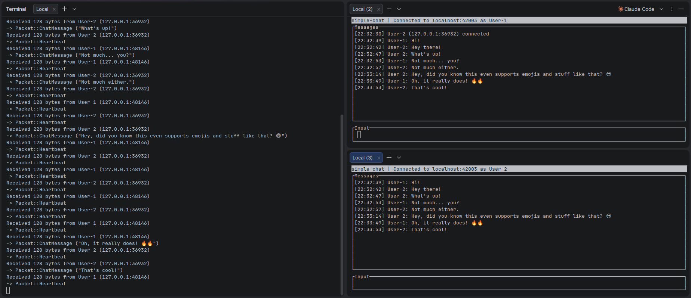

# simple-chat

A TUI-based chat client and server for local networks, featuring encryption and ssh-like host configuration.
simple-chat lets you chat with others on the same network (a LAN, a tailscale tailnet or similar) via a simple terminal UI.
It requires no classical internet connection (in the sense that you have to be able to reach the world wide web like google.com or similar), no accounts and no third-party servers. You control everything, and you're the
only one who sees the messages unencrypted.

The source lives under [src](src), split into [client](src/client), [server](src/server) and the shared
[packets](src/packets), [encrypt.rs](src/encrypt.rs) and [config](src/config) modules.



---

## 1. Building, Running and Documentation

### 1.1. Requirements

- **Rust** (stable, edition 2024)

Prebuilt binaries for Linux and Windows are attached to each tagged release.

### 1.2. Building

```
cargo build --release
```

The binary ends up at `target/release/simple-chat`.

### 1.3. Hosting a Server

```
simple-chat server <name> --new --port 42003   # create a server (port is optional, 42003 by default)
simple-chat server <name> --show-key           # print the key as text and QR code
simple-chat server <name>                      # start the server
simple-chat server --list                      # list created servers
simple-chat server <name> --delete             # delete a server
```

### 1.4. Joining a Server

```
simple-chat client <name> --add --address 192.168.1.10   # save a server (port is optional, 42003 by default)
simple-chat client <name>                                # connect to a saved server
simple-chat client <name> --name alice                   # connect with a different user name
simple-chat client --list                                # list saved servers
simple-chat client <name> --remove                       # remove a saved server
```

Run `simple-chat --help`, `simple-chat server --help` or `simple-chat client --help` for the full option lists.
How conflicting or repeated arguments are resolved is documented in [docs/ARG_PRIORITY.md](docs/ARG_PRIORITY.md).

### 1.5. Configuration

Config files are created on demand in `~/.simple-chat/`:

| File           | Contents                                              |
|----------------|-------------------------------------------------------|
| `servers.toml` | Servers you host (name, port, key)                    |
| `clients.toml` | Your user name and the servers you saved (name, address, key) |

---

This project is licensed under the **GNU General Public License v3.0** (GPL-3.0-only). See [LICENSE](LICENSE) for details.
